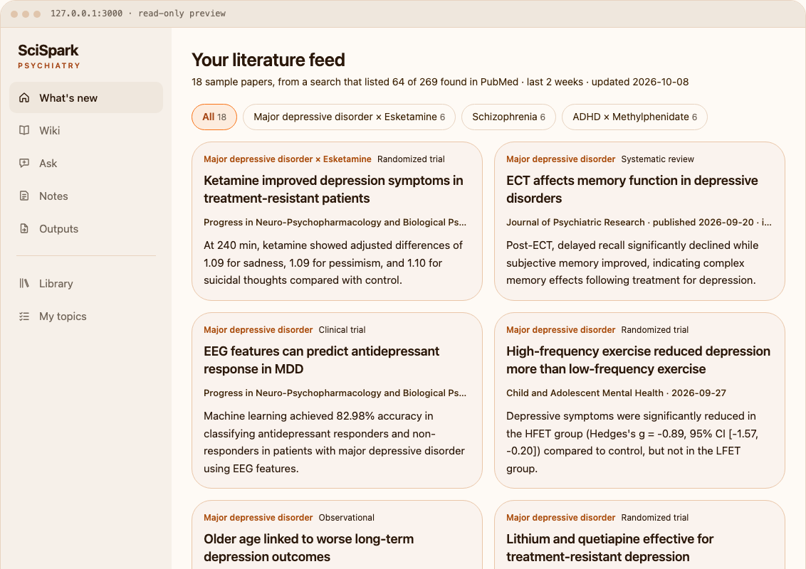
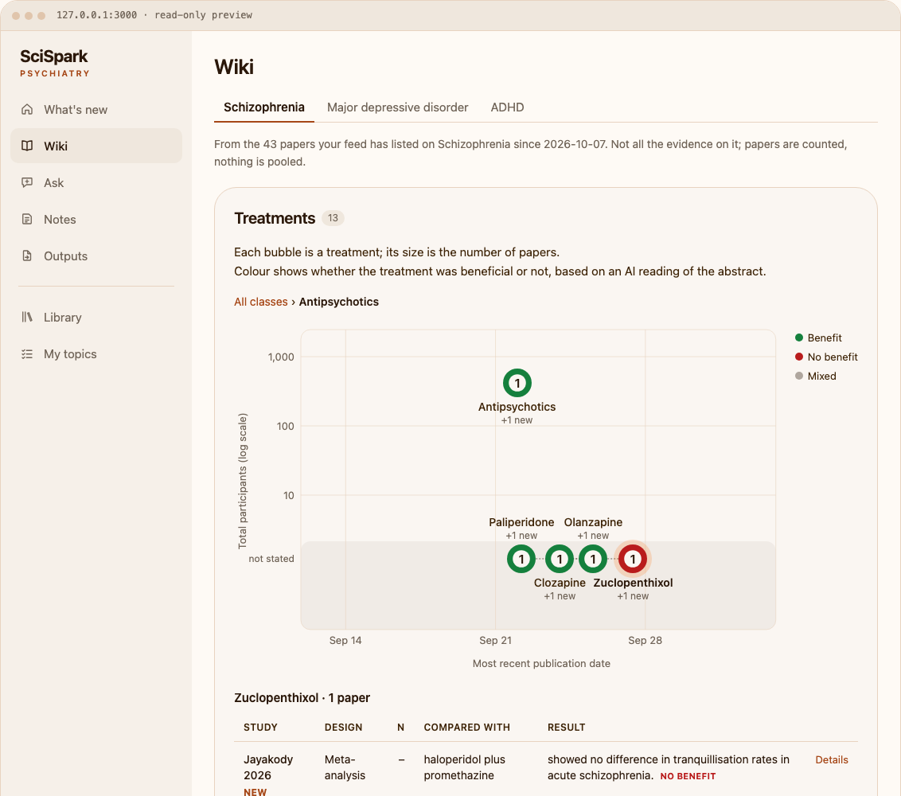
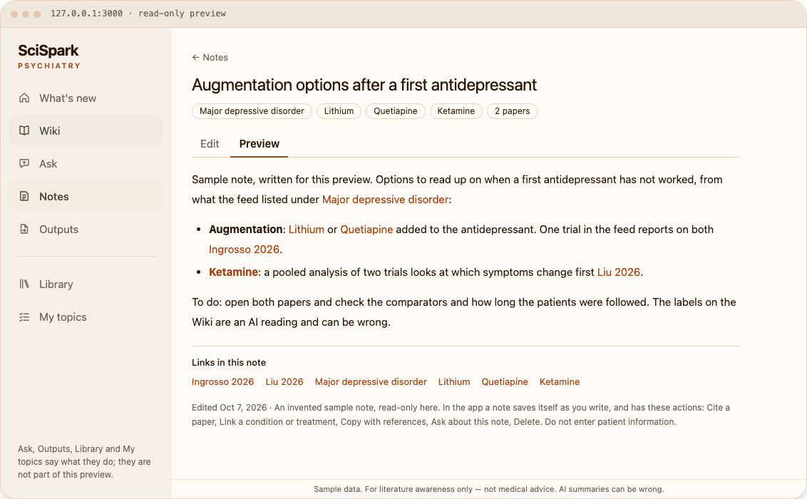

# SciSpark Psychiatry

SciSpark Psychiatry is a private, local-first literature feed and evidence workspace for psychiatry clinicians.

It is built on [SciSpark wiki](https://github.com/SciSpark-ai/scispark_wiki), our general research workspace,
and shares its design. Both help you keep up with the literature and turn what you read into lasting
knowledge. Use SciSpark wiki for knowledge management in any field. This edition is clinical-facing, adapted
to psychiatry first and designed to extend to other clinical specialties.

**[Try the interactive preview](docs/preview/)** · [Run it locally](#run-it-locally) · [How it works](docs/psychiatry/how-it-works.md)

<!-- TODO (owner): replace the preview link with its GitHub Pages address once Pages is on for docs/. -->

## Who it is for

For psychiatrists and residents who follow a few clinical questions closely and need to turn the literature
into their own work.

## What you can use it for

**1. Follow your clinical questions.** Pick the conditions, treatments and patient groups you care about.
SciSpark Psychiatry finds the new papers on each and keeps them together by condition.

**2. Weigh the evidence.** Not all studies count the same. Each paper shows its study design and sample size,
and every AI summary is checked against the paper.

**3. Turn evidence into outputs.** Write notes that cite your papers, then use them for a journal club, an
evidence summary, teaching, or a comparison with guidelines.

## Key features

**What's new** — your research feed
- New papers on the topics you follow, leading journals first
- Study-design tag and a one-sentence summary of the main finding on every paper
- An AI overview of what the new papers found, per topic
- Open a paper for its structured abstract and a longer digest

**Wiki** — your evidence base, by condition and treatment
- A map of the treatments studied: how recent, how many participants, what was found
- Every study behind a treatment, with design, sample size, comparison and result
- Safety findings listed separately

**Notes** — with citations and backlinks
- Cite papers and link conditions or treatments as you write
- See your notes on the papers and treatments they mention
- Get told when new papers arrive on what you wrote about
- Export with references

**Outputs** — projects with templates *(in progress)*
- Journal club, evidence summary, teaching material, guideline comparison

**Clinical evidence pipeline** *(in progress)*
- A quality score and report for each study: design, sample size, risk of bias, statistical power, effect size

**Private by design**
- Runs on your computer with your own AI key. Your papers and notes are plain files you own.

| What's new | Wiki | Notes |
|---|---|---|
|  |  |  |

Pictures of the preview, with sample data.

## What it does not do

- It does not use patient data. It works on published research only. Do not enter patient information.
- It does not give medical advice or make clinical decisions.
- It does not cover all the evidence, only the papers your feed has found. Nothing is pooled.
- Its AI summaries can be wrong. Open the paper before you rely on one.

## Status

Under active development.

| | |
|---|---|
| **Available now** | Literature feed for the topics you follow · evidence map per condition · linked notes with references · runs locally with your own AI key · interactive preview |
| **In progress** | Benchmarking and optimisation of the pipeline · reading PDFs you supply · integration of the clinical evidence pipeline · project templates |
| **Planned** | A hosted version · filters by population and outcome · effect sizes and forest plots |

Current limits are listed in [How it works](docs/psychiatry/how-it-works.md#known-limits).

## Run it locally

You need Node.js 20.9 or later and an AI provider key of your own.

```bash
git clone https://github.com/SciSpark-ai/scispark-wiki-psychiatry.git
cd scispark-wiki-psychiatry
npm ci
npm run dev
```

Open <http://127.0.0.1:3000>, connect your AI in Settings, add the conditions and treatments you follow under
**My topics**, and press **Refresh** on **What's new**. Your data stays in one folder on your computer
(`~/SciSpark/vault` by default). Settings and details are in
[How it works](docs/psychiatry/how-it-works.md#running-it-locally-data-and-settings).

## Built on

- [SciSpark wiki](https://github.com/SciSpark-ai/scispark_wiki), our general research workspace
- [LLM Wiki](https://github.com/nashsu/llm_wiki) and [Karpathy's LLM-wiki pattern](https://gist.github.com/karpathy/442a6bf555914893e9891c11519de94f)
- [Ai2 ScholarQA](https://github.com/allenai/ai2-scholarqa-lib) and [Microsoft ResearchStudio](https://github.com/microsoft/ResearchStudio), included under their own licences
- [PaperFlow](https://github.com/OpenRaiser/PaperFlow) and [PAHF](https://github.com/facebookresearch/PAHF), as design references
- PubMed, PubMed Central and MeSH for papers and vocabulary; OpenAlex for journal information

Copyright 2026 SciSpark contributors. [Apache License 2.0](LICENSE); see [NOTICE](NOTICE).
